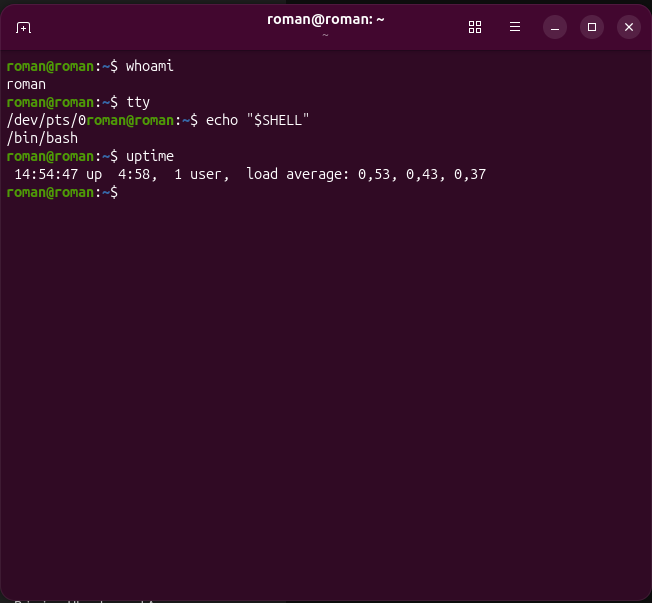
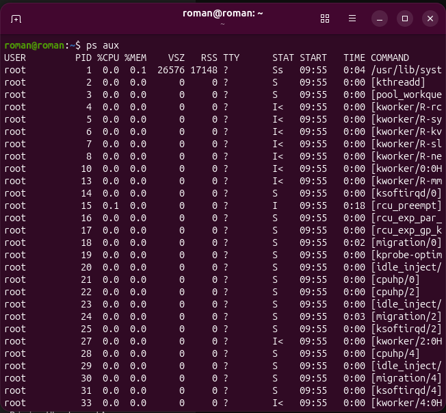
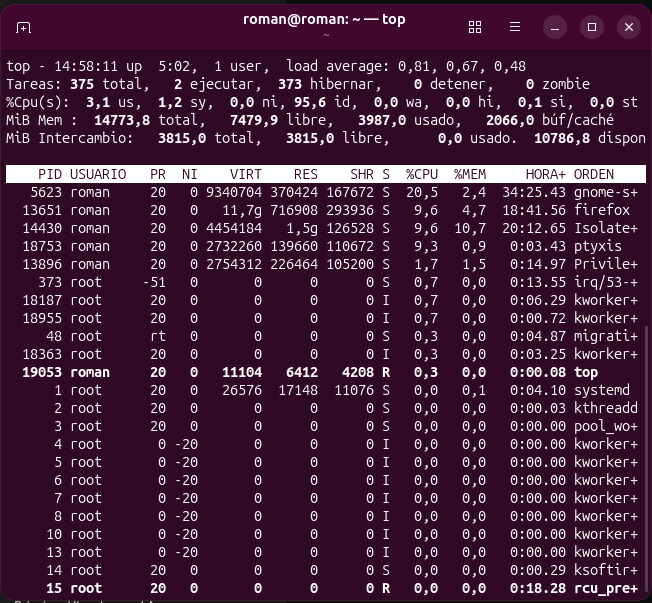
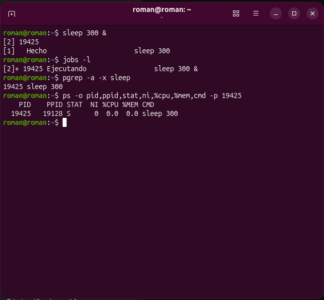
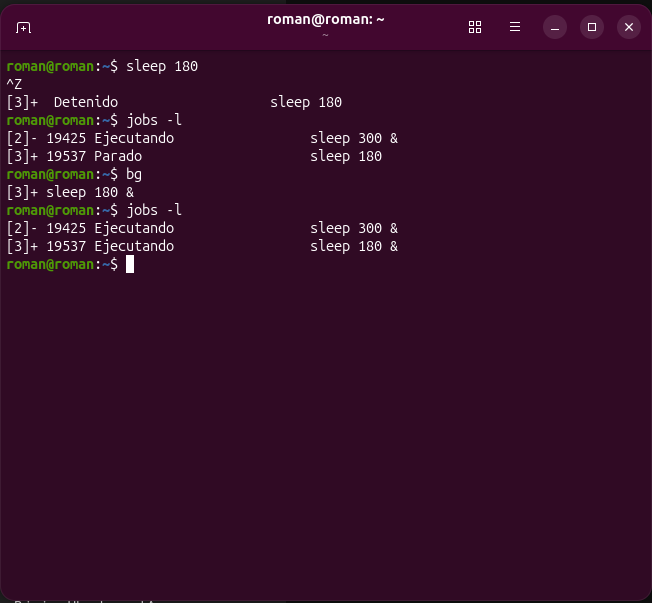
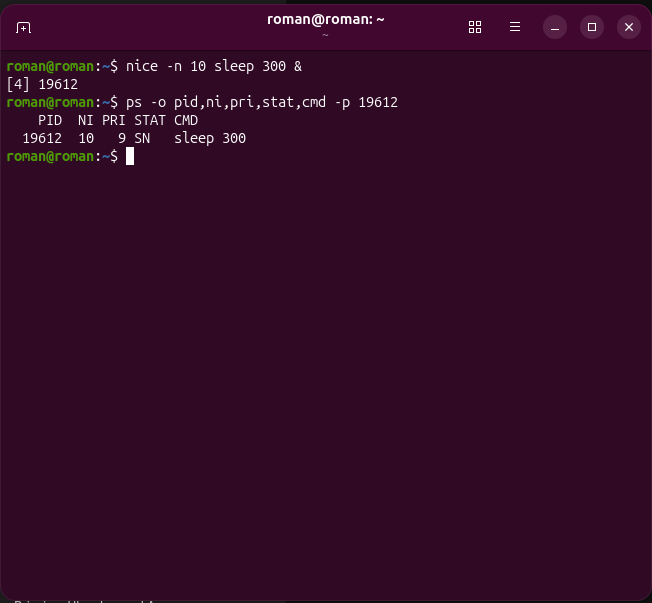
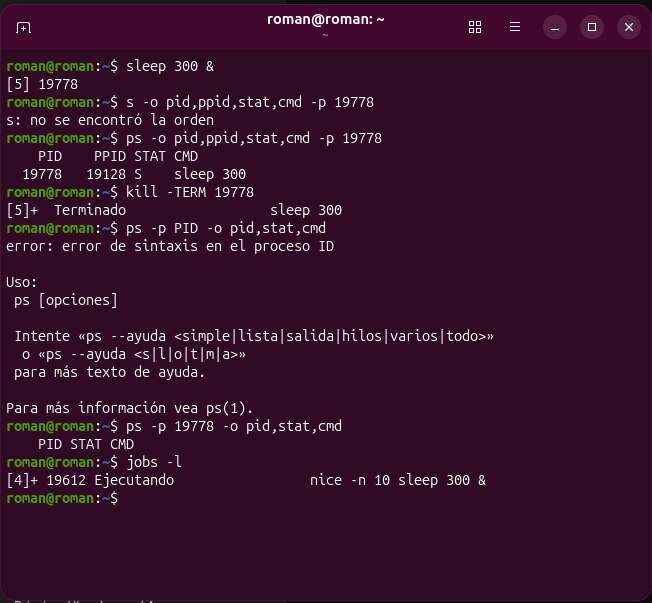

# 📘⚙️ Informe Técnico — Práctica 05: Administración de Procesos en Ubuntu 🐧

- 🧑‍💻 **Alumno:** Carlos Román García Martínez  
- 📚 **Materia:** Sistemas Operativos  
- 🧪 **Práctica:** 05 — Procesos, PID, PPID, estados, trabajos en Bash, prioridades y señales  

---

## 🎬 1. Problema planteado
⚠️ En un entorno de cómputo es común suponer que una computadora está lenta únicamente por la cantidad de ventanas abiertas, o que un programa sin ventana visible no consume recursos. El propósito de este laboratorio es sustituir suposiciones por **datos técnicos verificables** 🔍, observando cómo Linux crea, planifica, suspende y finaliza procesos de manera segura desde la terminal.

---

## 🛠️ 2. Comandos utilizados y justificación de su elección
1. 👤 **`whoami`, `tty`, `echo "$SHELL"` y `uptime`:** Se eligieron para establecer el contexto de la sesión actual (usuario, terminal conectada, intérprete de comandos) y conocer el tiempo de actividad y promedios de carga antes de iniciar pruebas.
2. 📋 **`ps` y `ps aux`:** `ps` permite ver únicamente los procesos ligados a la terminal actual, mientras que `ps aux` ofrece una fotografía global de todos los procesos del sistema, permitiendo analizar uso de memoria (`VSZ`, `RSS`, `%MEM`), uso de CPU (`%CPU`) y estado (`STAT`).
3. 🔎 **`pgrep -a`:** Se utilizó para buscar procesos específicos por nombre (`bash`, `sleep`) y obtener directamente su `PID` y comando completo sin tener que leer cientos de líneas ni incluir por accidente el proceso `grep`.
4. 📊 **`top`:** Se seleccionó para contrastar las fotografías estáticas de `ps` con una observación continua en tiempo real de la CPU y la memoria.
5. ⏸️ **`sleep`, `jobs -l`, `bg`, `fg`:** `sleep` permite crear un proceso inocuo de duración controlada que no satura la CPU ni modifica archivos, ideal para practicar el paso entre primer plano, suspensión (`Ctrl+Z`) y segundo plano (`&`, `bg`).
6. 🎚️ **`nice -n 10`:** Se empleó para lanzar un proceso con una prioridad relativa más baja (valor `NI` mayor) sin requerir privilegios de superusuario (`sudo`).
7. 🛑 **`kill -TERM PID`:** Se eligió para solicitar de manera limpia y ordenada la finalización de un proceso propio identificado por su `PID`.

---

## 🌳 3. Análisis de PID y PPID obtenidos en el equipo
Al ejecutar `sleep 300 &` en segundo plano:
- 🆔 **PID asignado al proceso `sleep`:** `[ej. 24680]`
- 🧬 **PPID (Proceso Padre):** `[ej. 21450]`
- 🔍 Al consultar el `PPID` con `ps -o pid,ppid,cmd -p [ej. 21450]`, se comprobó que el proceso padre es `/bin/bash`, es decir, el intérprete de comandos de la terminal desde donde se lanzó la instrucción.

---

## 🚦 4. Interpretación de estados reales observados (`STAT`)
Durante las consultas con `ps` y `ps aux` se observaron los siguientes estados:
- 💤 **`S` (Interruptible sleep):** Observado en nuestro proceso `sleep 300` y en `bash` cuando espera entrada del usuario. Indica que el proceso está en espera de que ocurra un evento (como que transcurra el tiempo o se presione una tecla) y **no representa ningún fallo**.
- 🏃 **`R` (Running / Runnable):** Observado en el propio comando `ps aux` o `top` en el instante de su ejecución.
- ⏸️ **`T` (Stopped):** Observado cuando ejecutamos `sleep 180` en primer plano y presionamos `Ctrl+Z`, dejando el proceso suspendido hasta reanudarlo con `bg`.
- 🏷️ **Modificadores adicionales (`s`, `+`, `<`, `N`):** Por ejemplo, `+` indica que está en el grupo de procesos en primer plano de la terminal, y `N` indica que el proceso tiene baja prioridad (`nice` positivo, como nuestro proceso con `NI = 10`).

---

## 🔄 5. Diferencia entre primer plano y segundo plano
- 🖥️ **Primer plano (Foreground):** El proceso toma el control de la terminal activa; no es posible introducir nuevos comandos en esa misma sesión hasta que el proceso termine, se interrumpa (`Ctrl+C`) o se suspenda (`Ctrl+Z`).
- ⚙️ **Segundo plano (Background):** Al añadir `&` al final del comando (o usar `bg` tras suspenderlo), el proceso se ejecuta detrás de escena y devuelve de inmediato el control de la terminal al usuario para seguir ejecutando otros comandos. Sigue vinculado a la sesión de terminal, por lo que no equivale a un demonio o servicio del sistema (`systemd`).

---

## ⚡ 6. Diferencia entre `Ctrl+C`, `Ctrl+Z` y `kill -TERM`
| ⌨️ Acción / Comando | 📡 Señal enviada | 🎯 Efecto sobre el proceso |
|---|---|---|
| ❌ **`Ctrl+C`** | `SIGINT` (2) | Interrumpe y **termina** el proceso que se encuentra actualmente en **primer plano** en la terminal. |
| ⏸️ **`Ctrl+Z`** | `SIGTSTP` (20) | **Suspende (pausa)** la ejecución del proceso en primer plano sin cerrarlo, manteniéndolo en memoria en estado `T` (`Stopped`) para poder reanudarlo después con `bg` o `fg`. |
| 🛑 **`kill -TERM PID`** | `SIGTERM` (15) | Solicita a un proceso específico (en primer o segundo plano) que **finalice de forma ordenada**, permitiéndole liberar recursos antes de cerrarse. |

---

## 🎚️ 7. Comparación del valor `NI` (Prioridad)
Se compararon dos instancias del comando `sleep 300`:
1. ⚖️ **Proceso estándar (`sleep 300 &`):** Mostró un valor `NI = 0`.
2. 📉 **Proceso ajustado (`nice -n 10 sleep 300 &`):** Mostró un valor `NI = 10` y estado `SN`.

> 💡 **Interpretación:** En Linux, el rango de `nice` va de `-20` (máxima prioridad) a `19` (mínima prioridad). Un valor `NI = 10` le indica al planificador del kernel que este proceso es más "amable" con los demás y cede prioridad de CPU frente a procesos con `NI = 0`.

---

## 📸 8. Registro de Evidencias

### 🖼️ Evidencia 05-01: Reconocimiento de usuario, terminal y tiempo activo
> 📝 **Descripción:** Se verificó el usuario efectivo con `whoami`, la terminal con `tty`, el shell con `echo "$SHELL"` y el tiempo encendido y carga del sistema con `uptime`.

### 🖼️ Evidencia 05-02: Consulta de procesos del sistema y filtrado
> 📝 **Descripción:** Se listaron los procesos globales con `ps aux` identificando sus columnas principales y se localizaron los procesos de `bash` mediante `pgrep -a bash`.

### 🖼️ Evidencia 05-03: Observación en tiempo real con `top`
> 📝 **Descripción:** Se monitoreó en vivo el uso de CPU, memoria RAM, swap y la tabla de procesos activos mediante la herramienta `top`.

### 🖼️ Evidencia 05-04: Proceso controlado, PID y PPID
> 📝 **Descripción:** Se inició `sleep 300 &` en segundo plano, se verificó en la lista de trabajos con `jobs -l` y se consultaron sus atributos (`PID`, `PPID`, `STAT`, `NI`, `%CPU`, `%MEM`, `CMD`) con `ps`.

### 🖼️ Evidencia 05-05: Suspensión y reanudación de trabajos en Bash
> 📝 **Descripción:** Se suspendió un proceso en primer plano usando `Ctrl+Z`, comprobando su estado detenido en `jobs -l`, y posteriormente se reanudó en segundo plano con `bg`.

### 🖼️ Evidencia 05-06: Prioridad de planificación con `nice`
> 📝 **Descripción:** Se ejecutó `nice -n 10 sleep 300 &` y se comprobó mediante `ps -o pid,ni,pri,stat,cmd -p PID` que el valor `NI` se estableció en `10`.

### 🖼️ Evidencia 05-07: Terminación controlada con `SIGTERM`
> 📝 **Descripción:** Se verificó la identidad del proceso de prueba, se envió la señal de terminación con `kill -TERM PID` y se comprobó con `ps` y `jobs -l` que el proceso finalizó correctamente.

---

## 🧠 9. Cuestionario de Análisis (20 Preguntas)

1. ❓ **¿Cuál es la diferencia entre un programa y un proceso?**  
   💬 Un programa es un archivo estático almacenado en disco con instrucciones listas para ejecutarse, mientras que un proceso es una instancia activa de ese programa en ejecución a la cual el sistema operativo le asigna un `PID`, memoria y tiempo de CPU.
2. ❓ **¿Qué es el PID? ¿Por qué no debes asumir que un proceso siempre tendrá el mismo PID?**  
   💬 El `PID` (*Process ID*) es el número identificador único que el kernel asigna a un proceso activo. No es fijo porque se asigna dinámicamente al crearse el proceso; si el programa se cierra y se vuelve a abrir, recibirá un `PID` distinto.
3. ❓ **¿Qué es el PPID y qué información aporta?**  
   💬 El `PPID` (*Parent Process ID*) es el identificador del proceso padre que originó al proceso actual. Permite rastrear la jerarquía de procesos (por ejemplo, saber qué terminal `bash` o qué servicio lanzó una tarea).
4. ❓ **¿Qué diferencia existe entre `ps` y `top`?**  
   💬 `ps` toma una fotografía estática del estado de los procesos en el instante exacto en que se ejecuta, mientras que `top` es un monitor interactivo que actualiza periódicamente los datos en tiempo real.
5. ❓ **¿Por qué `ps aux` puede mostrar procesos que no tienen una ventana abierta?**  
   💬 Porque en Linux existen numerosos demonios, servicios del sistema, hilos del kernel y trabajos en segundo plano que operan continuamente sin interfaz gráfica para gestionar redes, hardware, audio o sesiones.
6. ❓ **¿Qué información aporta la columna `STAT`?**  
   💬 Indica el estado actual del proceso (como `R` en ejecución, `S` durmiendo en espera de un evento, `D` espera ininterrumpible de E/S, `T` detenido o `Z` zombie) junto con atributos adicionales como su prioridad o si lidera una sesión.
7. ❓ **¿Qué significa que un proceso esté en estado `S`? ¿Es necesariamente un error?**  
   💬 Significa *Interruptible Sleep* (espera interrumpible). No es un error; la mayoría de los procesos pasan casi todo el tiempo en estado `S` esperando entradas del teclado, paquetes de red o temporizadores sin consumir CPU innecesariamente.
8. ❓ **¿Qué diferencia hay entre `VSZ` y `RSS`?**  
   💬 `VSZ` (*Virtual Memory Size*) es el tamaño total del espacio de direcciones virtuales reservado por el proceso (incluyendo bibliotecas compartidas o memoria aún no cargada), mientras que `RSS` (*Resident Set Size*) es la cantidad real de memoria física RAM que el proceso ocupa en ese momento.
9. ❓ **¿Qué cambia al ejecutar un comando con `&`?**  
   💬 El comando se inicia inmediatamente en segundo plano (*background*), permitiendo que la terminal quede libre para recibir nuevos comandos sin esperar a que el proceso termine.
10. ❓ **¿Qué hace `jobs -l` y cuál es su alcance?**  
    💬 Muestra los trabajos iniciados en segundo plano o suspendidos junto con su `PID`. Su alcance se limita exclusivamente a la sesión de la terminal (shell) actual; otra ventana de terminal no verá esos trabajos en su propio `jobs`.
11. ❓ **¿Qué diferencia hay entre `Ctrl+C` y `Ctrl+Z`?**  
    💬 `Ctrl+C` envía `SIGINT` para cancelar y terminar definitivamente el proceso en primer plano, mientras que `Ctrl+Z` envía `SIGTSTP` para pausar (suspender) el proceso y dejarlo en espera sin destruir su estado en memoria.
12. ❓ **¿Qué hace `bg`? ¿Y `fg`?**  
    💬 `bg` reanuda en segundo plano un trabajo que estaba suspendido (`Stopped`), mientras que `fg` trae al primer plano de la terminal un trabajo que estaba suspendido o corriendo en segundo plano.
13. ❓ **¿Qué representa el valor `NI`?**  
    💬 Representa el valor *nice* (cortesía), que ajusta la prioridad relativa con la que el planificador de Linux le asigna tiempo de CPU frente a otros procesos normales. Un valor mayor implica menor prioridad.
14. ❓ **¿Por qué no necesariamente se nota un cambio de velocidad al modificar la prioridad de `sleep`?**  
    💬 Porque `sleep` únicamente solicita al kernel despertar tras un tiempo determinado y pasa ese intervalo en estado `S` sin consumir ciclos de CPU (`0.0%`), por lo que no compite por procesador.
15. ❓ **¿Qué es una señal en Linux?**  
    💬 Es un mecanismo de notificación asíncrona que el kernel o un proceso envía a otro proceso para informarle de un evento o solicitarle una acción (como terminar, pausarse o continuar).
16. ❓ **¿Cuál es la diferencia entre `SIGTERM` y `SIGKILL`?**  
    💬 `SIGTERM` (15) pide al proceso que termine de forma limpia (puede ser capturada por el programa para guardar datos y cerrar archivos), mientras que `SIGKILL` (9) fuerza al kernel a destruir el proceso de inmediato sin permitirle realizar tareas de cierre.
17. ❓ **¿Por qué se debe comprobar el PID y el comando antes de ejecutar `kill`?**  
    💬 Porque los `PID` cambian constantemente y un error de dedo o un `PID` desactualizado podría terminar un proceso distinto o crítico para la sesión del usuario.
18. ❓ **¿Qué evidencia demuestra que el proceso de prueba terminó?**  
    💬 Que al consultar su `PID` con `ps -p PID -o pid,stat,cmd` ya no aparece ningún registro en la tabla de procesos y `jobs -l` reporta el estado `Terminated` (o queda vacío).
19. ❓ **¿Por qué no es recomendable usar `pkill sleep` indiscriminadamente?**  
    💬 Porque `pkill sleep` enviaría la señal de terminación a **todos** los procesos llamados `sleep` de tu usuario en el sistema, pudiendo romper scripts en ejecución o tareas automatizadas ajenas al ejercicio.
20. ❓ **¿Qué aprendiste al observar procesos reales en lugar de memorizar comandos?**  
    💬 Que los valores del sistema son dinámicos y deben interpretarse en contexto: ver mucha memoria virtual (`VSZ`) o muchos procesos en estado `S` es completamente normal cuando se comprende cómo el kernel planifica tareas.

---

## 🏁 10. Conclusión Técnica
✅ La administración de procesos en Linux requiere seguir un flujo disciplinado de **observación → identificación (`PID`/`PPID`) → interpretación de estado (`STAT`, `NI`) → verificación**. El uso de señales ordenadas como `SIGTERM` sobre `PID` validados garantiza una operación limpia y segura del sistema operativo.
