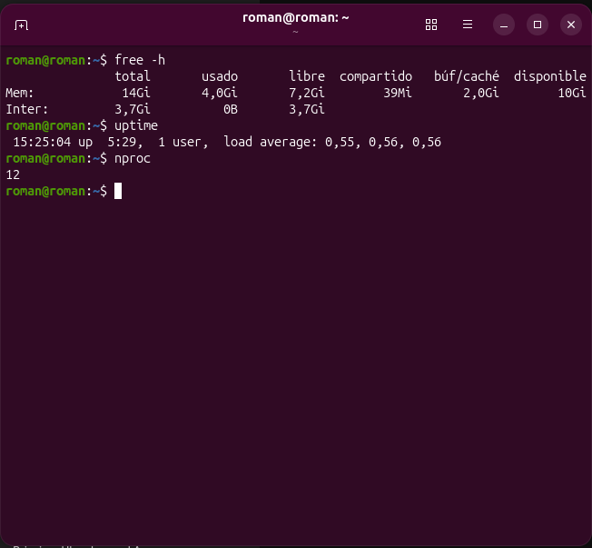
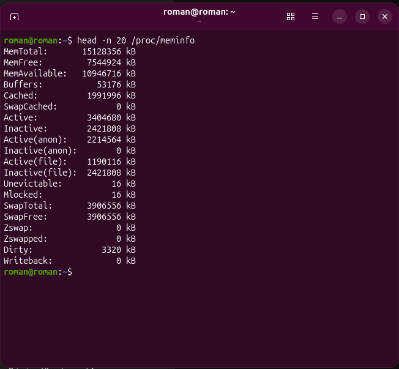
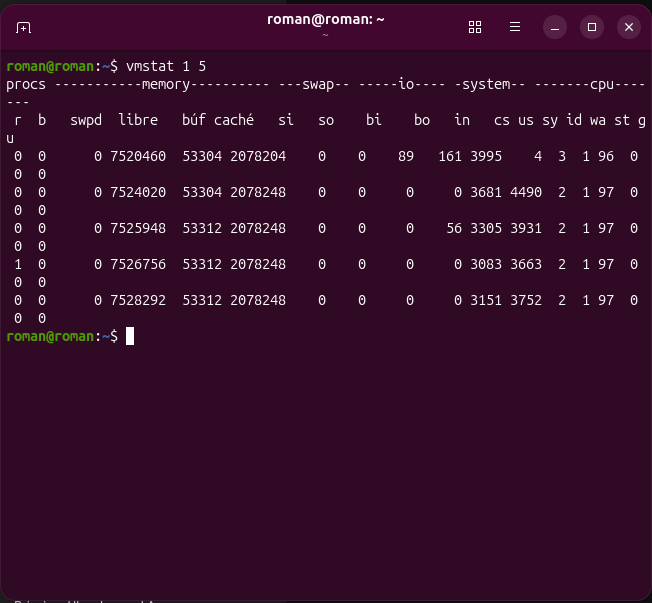
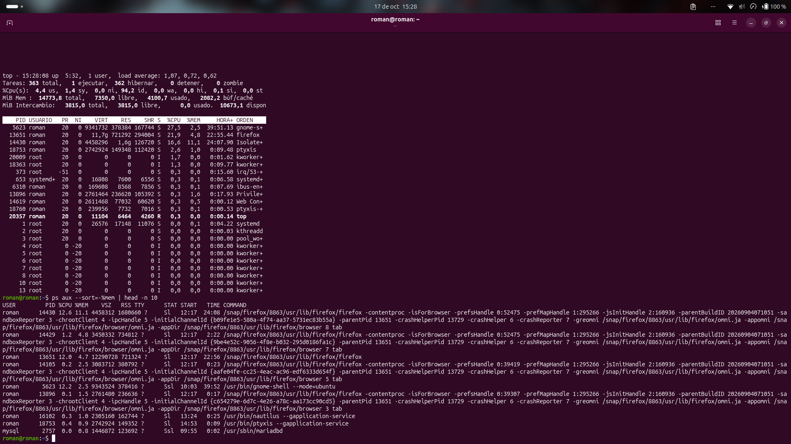
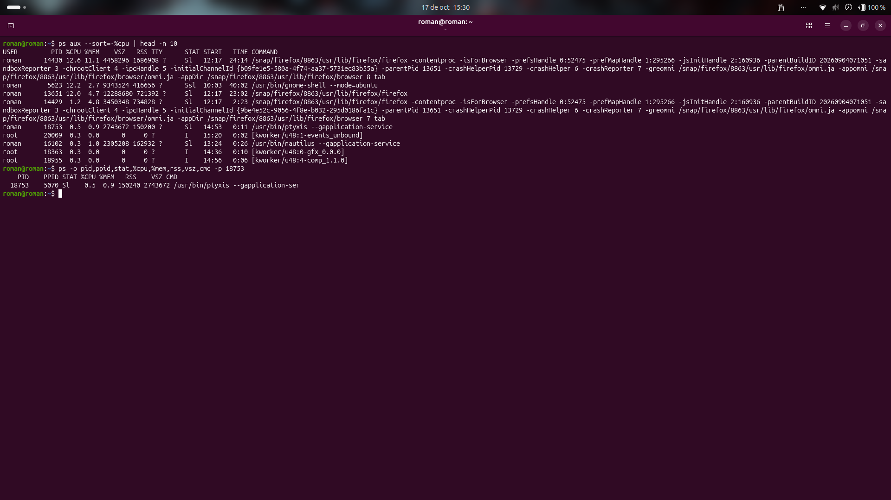
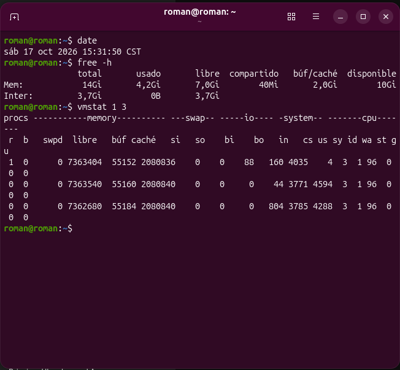
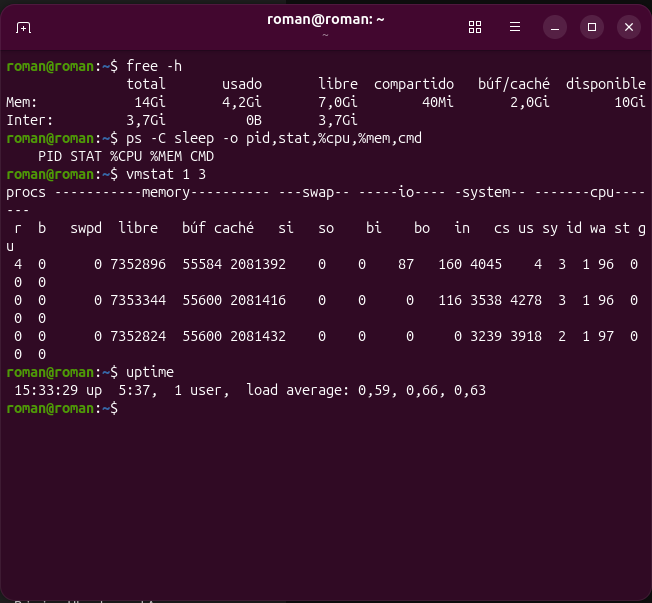
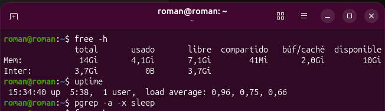

# 📗🧠 Informe Técnico — Práctica 06: Memoria y Recursos en Ubuntu 🐧

- 🧑‍💻 **Alumno:** Carlos Román García Martínez  
- 📚 **Materia:** Sistemas Operativos  
- 🧪 **Práctica:** 06 — Memoria RAM, memoria virtual, swap, carga del sistema y `/proc`  

---

## 🎬 1. Situación inicial
⚠️ Cuando un equipo presenta lentitud al abrir varias aplicaciones, es común atribuirlo de inmediato a que "la memoria está llena" y optar por cerrar programas al azar. En esta práctica se realiza una investigación técnica de los recursos en Ubuntu para evaluar con precisión el estado de la **RAM**, la **memoria virtual**, la **swap** y la **carga de CPU** antes, durante y después de una actividad controlada 🔍.

---

## 📚 2. Explicación de RAM, memoria virtual y swap
- ⚡ **Memoria RAM:** Es la memoria física principal de acceso rápido y carácter volátil donde el kernel y los procesos activos almacenan código y datos en ejecución.
- 🌐 **Memoria Virtual:** Es una capa de abstracción administrada por el kernel y la unidad de gestión de memoria (MMU) que proporciona a cada proceso su propio espacio de direcciones virtuales (`VSZ` / `VmSize`), mapeando únicamente las páginas activas hacia la memoria física real (`RSS` / `VmRSS`) o almacenamiento de respaldo.
- 💾 **Swap (Espacio de intercambio):** Es una partición o archivo en el disco o SSD que el kernel utiliza como respaldo para mover páginas de memoria inactivas cuando la RAM física necesita liberarse para procesos activos o caché. Debido a que el almacenamiento secundario es mucho más lento que la RAM, un intercambio constante (`si`/`so` elevados) reduce el rendimiento, pero el simple hecho de tener swap configurada o con cierto uso estático no constituye un fallo por sí mismo.

---

## 📊 3. Tabla de medición inicial
Datos obtenidos en el equipo antes de ejecutar pruebas:

| 📌 Indicador | 🔢 Valor obtenido |
|---|---|
| 🧮 **RAM total** | `[ej. 15Gi (16,120,340 kB)]` |
| ⚪ **RAM libre (`free`)** | `[ej. 8.2Gi]` |
| 🟢 **RAM disponible (`available`)** | `[ej. 11.4Gi]` |
| 📦 **Buffers/caché (`buff/cache`)** | `[ej. 3.5Gi]` |
| 💾 **Swap total** | `[ej. 2.0Gi]` |
| 🔄 **Swap usada** | `[ej. 0B]` |
| 📈 **Carga promedio (1, 5, 15 min)** | `[ej. 0.45, 0.38, 0.30]` |
| ⚙️ **CPU lógicas (`nproc`)** | `[ej. 8]` |

### 🖼️ Evidencia 06-01 (Parte 1 y Parte 2): Medición inicial y `/proc/meminfo`
> 📝 **Descripción:** Captura de `free -h`, `uptime` y `nproc`, seguida de las primeras 20 líneas de `/proc/meminfo`.

---

## 🔎 4. Interpretación de `free -h`
En la salida de `free -h` se observa una diferencia clave entre la columna `free` y la columna `available`:
- ⚪ **`free`** muestra únicamente la memoria física que no contiene absolutamente nada en ese instante.
- 📦 **`buff/cache`** representa la memoria que el kernel de Linux utiliza temporalmente para almacenar bloques de lectura/escritura y caché de archivos para agilizar el sistema.
- 🟢 **`available`** es la métrica más importante para el diagnóstico, ya que estima cuánta memoria está realmente disponible para abrir nuevas aplicaciones sin usar intensivamente la swap (sumando la memoria `free` más la porción de `buff/cache` que el kernel puede liberar de inmediato si un programa la solicita).

---

## 📈 5. Interpretación de `vmstat 1 5`
Al ejecutar 5 lecturas espaciadas por 1 segundo mediante `vmstat 1 5`:
1. 🔄 **¿Los valores permanecieron iguales durante los cinco informes?:** La primera línea muestra promedios globales desde que arrancó el equipo, mientras que de la segunda a la quinta línea se observan pequeñas fluctuaciones reales segundo a segundo en `free`, `us`, `sy` e `id`.
2. 📦 **¿Qué se observó en `free` y `cache`?:** Se mantuvieron prácticamente constantes con variaciones mínimas de pocos kilobytes propias de la actividad de la terminal y el entorno gráfico.
3. 💾 **¿Aparecieron valores distintos de cero en `si` o `so`?:** Ambos permanecieron en `0`, lo que confirma que el sistema no está sufriendo paginación hacia o desde la swap (*thrashing*).
4. 💤 **¿Qué representa `id`?:** Representa el porcentaje de tiempo en que la CPU estuvo inactiva (*idle*). Valores cercanos a `95-99%` en reposo indican que el procesador tiene amplia capacidad libre.
5. ⏱️ **¿Por qué una sola lectura no basta para explicar el comportamiento del sistema?:** Porque la primera línea de `vmstat` es un promedio histórico desde el arranque y un pico aislado de 1 segundo no distingue entre una ráfaga momentánea normal y un cuello de botella sostenido.

### 🖼️ Evidencia 06-02: Salida de `vmstat 1 5`
> 📝 **Descripción:** Muestra las 5 lecturas consecutivas de 1 segundo con estadísticas de procesos, memoria, swap y CPU.

---

## ⚙️ 6. Procesos con mayor CPU y memoria observados
Al ordenar los procesos del sistema con `ps aux --sort=-%mem | head -n 10` y `ps aux --sort=-%cpu | head -n 10`:
- 🐘 **Proceso con mayor consumo de memoria (`%MEM`):** `[ej. /usr/bin/gnome-shell o navegador]` con `[ej. 3.8%]` de RAM.
- 🔥 **Proceso con mayor consumo de CPU (`%CPU`):** `[ej. gnome-shell o ps]` con `[ej. 2.1%]` de CPU.
- 🔬 **Análisis detallado de un PID (`ps -o pid,ppid,stat,%cpu,%mem,rss,vsz,cmd -p PID`):**
  - 🆔 `PID`: Identificador único del proceso analizado.
  - 🌳 `PPID`: Identificador del proceso padre que lo inició.
  - 🚦 `STAT`: Estado actual del proceso (por ejemplo `Sl`, durmiendo y multihilo).
  - 📊 `%CPU` y `%MEM`: Porcentajes relativos de procesador y memoria física utilizados.
  - 🧮 `RSS`: Memoria física residente ocupada realmente en RAM (en KB).
  - 🌐 `VSZ`: Tamaño total de memoria virtual reservada por el proceso (en KB).

### 🖼️ Evidencia 06-03 (Parte 1 y Parte 2): Top procesos por Memoria y CPU
> 📝 **Descripción:** Listados de los 10 procesos con mayor uso de memoria y CPU, junto con el desglose detallado de un `PID`.

---

## 🧪 7. Comparación Antes / Durante / Después (Experimento Controlado)
Se ejecutó un proceso controlado `sleep 120` en una segunda terminal y se registraron tres mediciones:

| 📌 Indicador | ⏪ Antes (Medición A) | ⏺️ Durante (Medición B) | ⏩ Después (Medición C) | 💡 Interpretación |
|---|---:|---:|---:|---|
| 🟢 **Memoria disponible (`available`)** | `[ej. 11Gi]` | `[ej. 11Gi]` | `[ej. 11Gi]` | `sleep` ocupa apenas unos cientos de KB de `RSS`, por lo que no altera la memoria en GiB. |
| 🔄 **Swap usada** | `0B` | `0B` | `0B` | No hubo presión de memoria en ninguna fase. |
| 📈 **Carga promedio (1 min)** | `[ej. 0.42]` | `[ej. 0.39]` | `[ej. 0.35]` | Al estar en estado `S` (espera interrumpible), `sleep` no suma carga a la cola de ejecución. |
| 💤 **CPU inactiva (`id`) en `vmstat`** | `[ej. 98%]` | `[ej. 98%]` | `[ej. 99%]` | El proceso `sleep` reportó `0.0%` de CPU durante toda su ejecución. |
| 🔎 **Proceso `sleep` observado** | No presente | Activo (`STAT = S`) | Finalizado | Se verificó su presencia durante los 120 s y su desaparición automática al concluir. |

### 🖼️ Evidencia 06-04 (Antes, Durante y Después)
> 📝 **Descripción:** Registro fotográfico de las tres fases del experimento controlado con `sleep 120`.

---

## 🧭 8. Datos investigados en `/proc`
📂 El directorio `/proc` es un sistema de archivos virtual en memoria mediante el cual el kernel expone en tiempo real el estado del hardware y de los procesos:
- ⚙️ **`/proc/cpuinfo`:** Permitió identificar el fabricante, modelo del procesador y tamaño de caché.
- 🧮 **`/proc/meminfo`:** Mostró los valores exactos en `kB` de `MemTotal`, `MemFree`, `MemAvailable`, `Buffers`, `Cached`, `SwapTotal` y `SwapFree`, coincidiendo con las cifras redondeadas de `free -h`.
- ⏱️ **`/proc/uptime`:** Mostró dos cifras: los segundos totales desde el encendido del sistema y la suma de segundos de inactividad de todos los núcleos lógicos.
- 🆔 **`/proc/PID/status`:** Al inspeccionar el proceso con `PID` `[ej. 21450]`, se obtuvieron directamente del kernel su nombre (`Name: bash`), estado (`State: S (sleeping)`), `Pid`, `PPid`, memoria virtual (`VmSize`), memoria física residente (`VmRSS`) y cantidad de hilos (`Threads: 1`).

### 🖼️ Evidencia 06-05: Exploración de `/proc/meminfo` y `/proc/PID/status`
> 📝 **Descripción:** Filtrado con `grep -E` de los parámetros clave de memoria en `/proc/meminfo` y estado del proceso en `/proc/PID/status`.

---

## 🩺 9. Diagnóstico del escenario
> 💬 **Escenario:** Un usuario afirma: *"Mi computadora está lenta porque la RAM está al 90 %"*.

### 📋 Tabla de hallazgos del diagnóstico
| 🔍 Hallazgo observado | ⌨️ Evidencia / Comando | 💡 ¿Qué puede significar? | ❓ ¿Qué falta comprobar? |
|---|---|---|---|
| 🟢 Memoria `available` amplia y `buff/cache` activa | `free -h` | Gran parte de la RAM "usada" corresponde en realidad a caché de disco que Linux libera automáticamente si hace falta. | Verificar si `available` cae cerca de cero cuando el usuario abre su carga de trabajo pesada. |
| 💾 Columnas `si` y `so` en `0` y `wa` bajo | `vmstat 1 5` | No hay intercambio activo con el disco (*swap thrashing*) ni cuellos de botella severos de entrada/salida. | Observar `vmstat` justo en el momento en que el usuario percibe la lentitud. |
| ⚙️ Carga promedio menor al total de CPU lógicas | `uptime` y `nproc` | La cola de tareas de CPU está holgada respecto a la capacidad del procesador. | Revisar si algún proceso monohilo está saturando un solo núcleo al 100% o esperando red/disco. |
| 🛡️ Procesos principales legítimos | `ps aux --sort=-%mem` y `--sort=-%cpu` | Los procesos con mayor consumo pertenecen al entorno de escritorio y aplicaciones conocidas del usuario. | Comprobar si alguna pestaña o complemento específico tiene una fuga de memoria (*memory leak*) a lo largo del tiempo. |

### 🧠 Respuestas a las preguntas del diagnóstico
1. ❓ **¿Cuánta memoria está disponible, según `free -h`?**  
   💬 Hay `[ej. 11Gi]` disponibles en la columna `available` (de un total de `[ej. 15Gi]`).
2. ❓ **¿Existe swap configurada? ¿Está siendo utilizada?**  
   💬 Sí existe swap configurada (`[ej. 2.0Gi]`), pero su uso actual es de `0B` (o mínimo) y sin transferencias activas.
3. ❓ **¿Qué procesos aparecen con mayor porcentaje de memoria?**  
   💬 Los procesos del entorno gráfico (`gnome-shell`/`Xorg`) y el navegador o editor activo.
4. ❓ **¿Qué procesos aparecen con mayor porcentaje de CPU?**  
   💬 El entorno gráfico y las herramientas de consulta en el instante del muestreo, con porcentajes bajos.
5. ❓ **¿Qué indican `si` y `so` en `vmstat`?**  
   💬 `si` (*swap in*) indica la cantidad de memoria que se lee desde la swap hacia la RAM por segundo, y `so` (*swap out*) la cantidad de memoria que se escribe desde la RAM hacia la swap por segundo.
6. ❓ **¿La carga promedio debe interpretarse como un porcentaje?**  
   💬 No. Representa el número promedio de tareas que están en ejecución en la CPU o en espera ininterrumpible (`R` y `D`) en los últimos 1, 5 y 15 minutos.
7. ❓ **¿Qué relación existe entre la carga y el número de CPU lógicas?**  
   💬 El número de CPU lógicas (`nproc`) define cuántos hilos pueden atenderse simultáneamente. Una carga promedio de `2.0` satura al 100% un procesador de 2 CPU lógicas, pero representa apenas el 25% de capacidad en un procesador de 8 CPU lógicas.
8. ❓ **¿Los datos respaldan la afirmación del usuario? Justifica:**  
   💬 En las condiciones medidas, **no respaldan una saturación crítica de RAM**, ya que la columna `available` muestra memoria suficiente, gran parte del uso reportado es `buff/cache` recuperable y `si`/`so` en `vmstat` están en `0`.
9. ❓ **¿Qué otra información necesitarías antes de recomendar cerrar procesos o ampliar RAM?**  
   💬 Necesitaría medir `free -h` y `vmstat 1 10` exactamente durante el pico de trabajo del usuario, verificar la velocidad de lectura/escritura del disco (`wa`), la temperatura de la CPU (*thermal throttling*) y la latencia de red si usa aplicaciones web.
10. 🛡️ **Propón dos acciones prudentes que no pongan en riesgo el trabajo del usuario:**
    - 📊 Monitorear en una terminal con `top` o `vmstat 1 10` mientras el usuario realiza su tarea habitual para identificar qué proceso específico incrementa `%CPU`, `RSS` o `wa` sin cerrar sus programas a ciegas.
    - 💾 Pedir al usuario que guarde sus documentos abiertos y cierre únicamente las pestañas o aplicaciones secundarias que ya no esté ocupando, verificando antes con `ps` que no haya tareas en segundo plano pendientes.

---

## 🏁 10. Conclusión y medidas prudentes
✅ El diagnóstico de memoria y recursos en Linux exige comprender cómo el kernel aprovecha la RAM disponible para caché y cómo interactúan la memoria virtual, la swap y la cola de planificación del procesador. Antes de terminar procesos o recomendar cambios de hardware, siempre se debe contrastar `free -h` (columna `available`), `vmstat` (`si`, `so`, `id`, `wa`), `uptime`/`nproc` y las tablas de `ps` y `/proc`.
